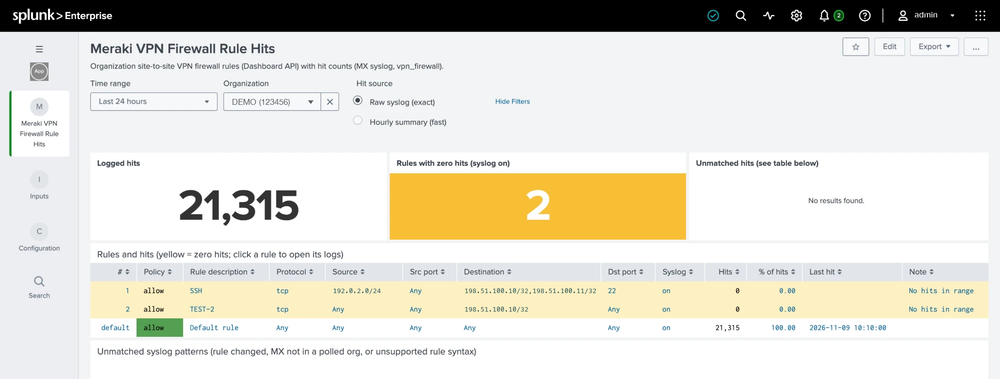

# TA-meraki-vpnfw: Meraki VPN Firewall Rule Hits

Shows every **organization site-to-site VPN firewall rule** next to its **hit count**.

- **Rules** come from the Dashboard API: `GET /organizations/{orgId}/appliance/vpn/vpnFirewallRules`.
- **Hits** come from MX syslog lines in the `vpn_firewall` category, which Splunk already collects.



Rules with zero hits are highlighted in yellow. Clicking a rule opens its raw syslog lines in Search.

## How a hit is matched to a rule

The MX syslog line carries no rule number or comment. It carries the rule's **compiled match expression**:

| API rule | Syslog `pattern:` text |
|---|---|
| allow tcp, src 192.0.2.0/24, dst 198.51.100.10/32,198.51.100.11/32, dport 22 | `allow tcp && (dst 198.51.100.10/32 \|\| dst 198.51.100.11/32) && (dst port 22) && (src 192.0.2.0/24)` |
| allow tcp, dst 198.51.100.10/32 | `allow tcp && (dst 198.51.100.10/32)` |
| Default rule | `allow all` |

Both sides are reduced to the same **signature**: lowercase, parentheses removed, terms sorted inside each clause, and the clauses themselves sorted. That makes the match independent of clause order.

- On the API side, `bin/meraki_vpnfw_signature.py` builds the signature.
- On the syslog side, the `meraki_vpnfw_parse` macro builds it.
- `tests/test_signature.py` checks that both produce the same output, using rule / syslog pairs captured from a live MX (addresses replaced with documentation ranges).

The org is found from the MX's MAC address. The syslog hostname (`mx67-00005e005301`) contains it, and it is looked up in the appliance list polled from the API.

## Data flow

```
Meraki API --(input, every 5 min)--> meraki:vpnfw:rule / meraki:vpnfw:appliance events
   --(saved searches, every 5 min)--> lookups meraki_vpnfw_rules.csv / meraki_vpnfw_appliances.csv
MX syslog (cisco:meraki, vpn_firewall) --`meraki_vpnfw_parse`--> signature
   --(hourly "Meraki VPN FW - Hits summary")--> summary index
Dashboard "Meraki VPN Firewall Rule Hits" = rules lookup + hits (raw syslog or summary)
```

## Install

1. Install `dist/TA-meraki-vpnfw-1.0.0.tar.gz` on the search head. On a single instance, install it there.
2. **Configuration → Accounts:** add an account with your API key. Read-only access is enough.
3. **Inputs → Add:** pick the account, enter your org IDs (for example `123456`), choose an index and set the interval to 300 s.
4. **Settings → Advanced search → Macros:** set these three macros to match your environment:
   - `meraki_vpnfw_syslog`: where the MX syslog is stored. Default: `index=syslog sourcetype=cisco:meraki`.
   - `meraki_vpnfw_api_index`: the index you chose in step 3. Default: `index=*`.
   - `meraki_vpnfw_summary_index`: the summary index. Default: `index=summary`.
5. Wait 5 minutes for the first lookup build, then open the **Meraki VPN Firewall Rule Hits** dashboard.

## Dashboard behaviour

- **Hits = n/a, Note "Syslog off":** the rule has syslog disabled, so the MX never logs it. Turn syslog on to count it.
- **Hits = 0, Note "shadowed by rule #N":** an earlier rule has the same match, so this rule can never be hit.
- **Unmatched patterns panel:** syslog lines that match no current rule. Common causes:
  - The rule was changed or deleted during the selected time range.
  - The MX belongs to an org that isn't polled.
  - The rule uses a syntax the TA doesn't handle yet. See the limits below.
- **Hit source:** "Raw syslog" counts exactly but is slower over long ranges. "Hourly summary" is fast but can be up to 1 hour behind. To fill the summary for past hours:
  `splunk cmd python fill_summary_index.py -app TA-meraki-vpnfw -name "Meraki VPN FW - Hits summary" -et -30d@h -lt @h -j 4 -dedup true`

## Limits (unverified syntax)

These rule forms were not seen in real syslog lines. If one doesn't match, it shows up in the Unmatched panel:

- Port ranges (`1000-2000`) and port lists (`80,443`).
- Source port values.
- Policy objects and groups, VLAN references, and FQDNs in source or destination.
- MX syslog hostnames that don't end in `-<12 hex MAC>`.

## Build

```bash
python -m venv .venv && .venv/bin/pip install splunk-add-on-ucc-framework
PATH=.venv/bin:$PATH ucc-gen build --source package --ta-version 1.0.0 --python-binary-name python
ucc-gen package --path output/TA-meraki-vpnfw -o dist
python3 -m unittest tests/test_signature.py
```
